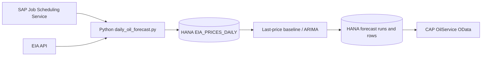

# Minimal daily oil forecast

This first version reuses the existing Cloud Foundry Python application,
EIA destination, CAP OilService, and HANA HDI container. It adds a daily
task and two tables; the existing instrument jobs and Fiori screens continue
to use their current workflow.



## Daily behavior

1. Update only EIA daily prices using the existing destination, retries,
   pagination, and CAP upserts, with a 30-day overlap for recent revisions.
2. Read up to 1,260 actual observations for WTI (default) or Brent. Keep
   observation gaps; reject duplicates, invalid values, and history older
   than seven calendar days. Zero and negative prices are valid inputs.
3. Compare the last-price baseline with ARIMA(1,1,0) at five rolling forecast
   origins. Evaluate each lead using only earlier observations. Select ARIMA
   only if its mean MAE for the requested leads is lower; use the baseline
   if ARIMA evaluation or its final fit fails.
4. Forecast the next five weekdays after the task runs. Account for the gap
   between the latest observation and the forecast issue date.
5. Save a new run and all forecast rows together through a CAP composition.
   A stable UUID makes retries of that run's PUT idempotent. Earlier runs
   remain available; failures exit nonzero without deleting past forecasts.

`ZFOR_OIL_FORECAST_RUNS` records the benchmark, model/version, observation
cutoff, UTC issue time, horizon, and interval level. `ZFOR_OIL_FORECASTS`
records dated USD/barrel predictions, bounds, and MAE for both models at
each observation lead.

## BTP setup

Deploy the CDS changes and updated Python application using the existing
MTA workflow. The task uses the current `CAP_SERVICE_URL`, `VCAP_SERVICES`,
XSUAA binding, and `EIA_API` destination (`URL.queries.api_key`). No API
keys or database passwords belong in source code.

Load historical EIA prices first using the existing `fetch_oil_data.py`
workflow. The updater's empty-table recovery window is too short for model
evaluation. Around 70 or more observations are needed for a five-day
forecast; a longer publication gap or horizon requires more.

Configure a daily Cloud Foundry task in the existing SAP Job Scheduling
Service, targeting `TIME_SERIES_FORECAST-python`, with this command:

```bash
python daily_oil_forecast.py
```

For a manual task run after deployment:

```bash
cf run-task TIME_SERIES_FORECAST-python --command "python daily_oil_forecast.py" --name daily-oil-forecast
```

Optional settings:

```bash
python daily_oil_forecast.py --benchmark BRENT --horizon 5 --overlap-days 30
```

Monitor the existing scheduler/task logs. On an EIA update or CAP write
failure, the command fails instead of publishing a successful run summary.

## Read results

Read the last issued run with its predictions:

```text
GET /odata/v4/oil/OIL_FORECAST_RUNS?$orderby=ISSUED_AT%20desc&$top=1&$expand=FORECASTS
```

Forecast rows are also exposed read-only at
`/odata/v4/oil/OIL_FORECASTS`. A dashboard can use these APIs later; this
change does not add or change dashboard screens.

## Prototype limits

- Forecast dates exclude weekends. Exchange-specific holidays are not yet
  configured; model steps and backtest MAE refer to observed-data leads.
- The 80% bands are model-based approximations, not calibrated guarantees.
  Baseline bands assume independent normally distributed price changes;
  ARIMA bands use statsmodels' prediction intervals.
- Five rolling origins provide a small initial comparison, not a claim of
  reliable outperformance. Evaluation uses today's historical values;
  historical publication timestamps and data vintages are not available.
- Existing EIA history is updated in place. An immutable raw-data archive,
  revision audit trail, larger backtests, and ongoing realized-error
  monitoring are later extensions.

