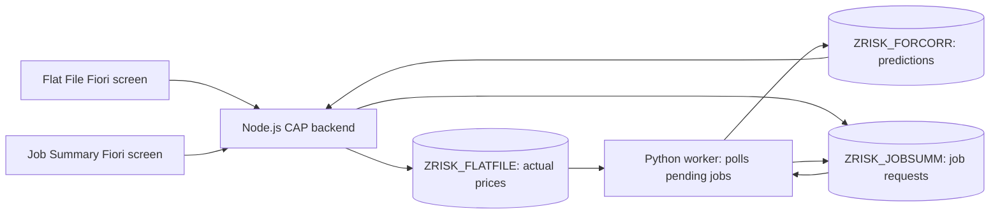

# How this project works, and the smallest useful forecasting workflow

This guide describes the checked-in code. Cloud Foundry applications, scheduler
jobs, and BTP configuration have not been inspected in a live account.

## The core application

You need two application processes and one database for the existing user workflow:



The frontend calls CAP over OData, which is an HTTP API. It does not call Python
to execute a Job Summary forecast. Python finds new jobs by querying HANA directly.

| Component | Source | What it does |
| --- | --- | --- |
| Flat File frontend | `app/flatfile/webapp/` | Views prices and uploads CSV files. |
| Job Summary frontend | `app/jobsumm/webapp/` | Selects model, instrument, start date, and horizon; creates jobs and shows status. |
| CAP backend | `srv/cat-service.cds`, `srv/cat-service.js` | Serves `/odata/v4/catalog/`; validates uploads, upserts actuals, assigns job IDs and inserts requests. |
| OilService, in the same CAP process | `srv/oil-service.cds` | Serves `/odata/v4/oil/` for external market datasets and the separate daily oil forecast. |
| Python Flask application and worker | `python/app.py` | Starts a background thread on application import; reads HANA, runs models, writes HANA results. Default local HTTP port: 5000. |
| HANA database | `db/*.cds`, `db/src/` | Stores application tables, reference synonym, sequence, and reporting view. |

There is no separate queue broker or model-training server. The job table acts
as the queue. Python's HTTP endpoints are auxiliary ingestion, diagnostic, and
older forecasting paths; the three-table job workflow uses the background thread.
Use `/health` for a basic HTTP check. Some diagnostic GET endpoints also write data.

## The three tables in your screenshot

| Table | Meaning | Main writer | Main reader |
| --- | --- | --- | --- |
| `ZRISK_FLATFILE` | Real historical observations used for training. | CAP CSV upload | Python models; Flat File screen |
| `ZRISK_JOBSUMM` | One user's forecast request, parameters, status and execution timestamps. | CAP creates; Python updates | Python worker; Job Summary screen |
| `ZRISK_FORCORR` | Predicted prices for one job, one row per forecast date. | Python | CAP `ForecastCorrelations`; reporting view |

`db/datamodel.cds` defines all three. A flat-file row is uniquely identified by
**DCSID + MIC + PRICETYPE + MKEYDT + PRICEDATE**. Uploading a matching key updates
the existing price. `PRICE` is the observed value; `PER`, `UOM`, and `CURRENCY`
describe its quantity basis and units. CAP records the uploaded `FILENAME` and
managed audit fields.

A job uses `TARDCSID` and `TARMIC` to select the target series. `MODEL` chooses
the implementation. `JOBSTARTDATE` is the **first prediction date**, not a timer
telling the worker when to start. `HORTY` is D/W/M; `HORVAL` is the count. For
ARIMA, 7 days and 1 week both produce seven calendar-day rows; 1 month means 30
calendar days. `SRCDCSID`/`SRCMIC` belong to the correlation form.

The job's numeric `JOB_ID` comes from the HANA `JOBSUMM_ID_V2` sequence. Result rows
carry that ID, which logically links predictions to their request. The current
CDS model does not declare this as a foreign-key association. `FORCORR` in job
requests uses `For`/`Corr`; in forecast output it stores a descriptive model label.

### What happens after clicking Execute

1. The browser posts a `JOBSUMM` request to CAP. CAP checks the model/start date,
   assigns a job ID, and saves status `ENTERED`.
2. Python looks for the oldest `ENTERED` job with `FORCORR='For'`. When there is
   no job, it waits five seconds before trying again.
3. Python marks it `RUNNING`, records execution time, and reads actual prices.
4. Only observations **before** `JOBSTARTDATE` enter training. The worker selects
   the target DCSID/MIC and gets price type, maturity, unit and currency from its
   latest eligible row. Multiple rows for that pair on the latest date cause
   failure: start with one spot-price series per pair.
5. It fits the requested model and generates dated predictions. The current
   ARIMA implementation is fixed at `(5,1,0)` and fits again for each job; there
   is no saved model registry.
6. Python inserts output into `ZRISK_FORCORR`, then marks the job `COMPLETED` and
   progress 100%. On an exception, it attempts to mark it `FAILED`; details go
   to Python logs.

Correlation has a form and can be saved, but this worker only processes `For`
jobs. A `Corr` job is not an implemented correlation calculation here.

## DCSID, MIC, and TBAC

The code treats DCSID as an instrument identifier and MIC as its market code.
It does not define a trustworthy expansion for DCSID/TBAC or validate MIC against
an exchange registry. Do not infer those business definitions from their names.

`db/tbac.cds` and `db/src/TBAC_DCS_MIC_SOURCE.hdbsynonym` reference an existing
`TBAC_REFERENCE.TBAC_DCS_MIC` table. CAP builds instrument dropdowns from a union
of that reference and distinct uploaded pairs. TBAC does not supply model prices.

ARIMA itself only needs dates and prices. DCSID/MIC still cannot be blank in the
current application: they are keys and required job inputs. For the included
sample, use `EIA_WTI / TEST`. `TEST` is an application test code, not an official
exchange MIC. `SP` labels spot prices; `MKEYDT=2099-12-31` is an explicit test
placeholder because spot prices have no contract maturity. `PER=1`, `UOM=BBL`,
`CURRENCY=USD` preserve the source's dollars-per-barrel meaning.

No TBAC rows need to be added for this series. However, the current union still
requires the TBAC synonym/table to resolve when querying dropdowns. Making that
lookup fully optional would be a separate small CDS change. Its business users
should agree before it is removed from the shared application.

## Everything else, and whether you need it now

`mta.yaml` packages the deployment; it is not a list of locally started servers.

| BTP component | Role | Needed for the first flat-file ARIMA test? |
| --- | --- | --- |
| Cloud Foundry Node app `TIME_SERIES_FORECAST-srv` | Hosts CAP. | Yes for the deployed UI workflow. |
| Cloud Foundry Python app `TIME_SERIES_FORECAST-python` | Gunicorn hosts Flask with one worker and its background job thread. | Yes for processing UI jobs. |
| HDI container `TIME_SERIES_FORECAST-db` | Application database schema in HANA. | Yes for the three-table workflow. |
| HDI db-deployer module | Applies database definitions during deployment. | Used when deploying; not a daily application process. |
| HTML5 Application Repository | Stores the two built frontends. | For deployed frontend hosting; local CAP serves their source. |
| XSUAA | Deployed sign-in and role permissions. | Deployed workflow; local development uses mocked users. |
| Destination service | Routes UI requests to CAP/UI5; stores external provider destinations. | Deployed routing; API destinations are unnecessary for local CSV generation. |
| Existing `TIME_SERIES_FORECAST-apl` service | HANA APL model connection. MTA currently binds it to Python. | ARIMA does not use APL, but the deployment still declares the binding. |
| SAP Build Work Zone | Launches the deployed tiles using managed routing. | Optional for local development; described in README, configured outside this MTA. |
| SAP Job Scheduling Service | Starts recurring CF tasks. | Later. README describes a setup; no scheduler job/resource is provisioned by this MTA. |
| Datasphere and SAP Analytics Cloud | Reporting models and charts. | Optional. README describes external setup; source contains the HANA calculation view. |
| App-content/destination-content modules | Upload frontend ZIPs and destination definitions. | Deployment steps, not additional running backends. |

The source cannot prove which remote applications or scheduler jobs are running
today. From an authenticated BTP development terminal, inspect them with
`cf apps`, `cf services`, and `cf tasks TIME_SERIES_FORECAST-python`; inspect
recurring schedules in Job Scheduling Service.

The reporting view `ZRISK_ACTUAL_FORECAST` combines actual and forecast rows for
analytics. The repository also has older `FORECAST_DATA_*` model paths and eight
external-data entities: daily EIA prices, weekly inventory, weekly refinery
utilization, weekly imports/exports, daily FRED currency, monthly FRED inflation,
daily Yahoo futures and annual World Bank macro data. These are not eight servers.
They are tables exposed by the same CAP OilService.

## Why you should not build and deploy every day

`npm run build` deletes generated deployment output, builds both frontends and
CAP/HDI artifacts, and creates `mta_archives/archive.mtar`. `npm run deploy`
publishes that archive to the currently targeted CF space. Use these when
publishing changes. Daily data updates should run an ingestion command or
scheduled task against the already deployed application.

For development, run CAP and Python locally against a **development HANA
container**. Local and deployed workers using the same database can both pick
the same job: this worker has no atomic job-claim mechanism. Keep one worker
active per development queue.

### One-time setup in your BTP development terminal

The simplest place is the existing SAP Business Application Studio environment
where your CF login and tools already work. A Windows setup also needs CF CLI,
Node, Python and the corresponding HANA connectivity.

```powershell
# Project root; after installing dependencies if needed:
npm ci
cf target
npx cds bind db --to TIME_SERIES_FORECAST-db
```

Select the team's development CF org/space before binding. The command records
a local binding in ignored `.cdsrc-private.json` and may create a service key.
Use a Python 3.12 virtual environment to match `python/runtime.txt`, activate
it, then install `python -m pip install -r python/requirements.txt`.

### Terminal 1: frontend plus CAP backend

```powershell
npx cds watch --profile hybrid --livereload false
```

Open `http://localhost:4004/flatfile/index.html` and
`http://localhost:4004/jobsumm/index.html`. The installed `cds-plugin-ui5`
mounts both UI5 applications inside CAP, so you do not need a frontend process
for each screen. Existing shortcuts also work with a binding profile:
`npm run watch-flatfile -- --profile hybrid` or
`npm run watch-jobsumm -- --profile hybrid`; start only one of these CAP commands.
`npm start` starts CAP without file watching and does not start Python.

Development auth is mocked; the configured development username/password are
in `package.json`. Production uses XSUAA and assigned role collections instead.
Running `npm start` inside only `app/flatfile` starts a UI5 server without the
required CAP OData proxy; it is not the complete development setup.

### Terminal 2: Python job worker

With the Python environment activated, run from the project root:

```powershell
npx cds bind --exec '--' python python/app.py
```

On Bash, use `npx cds bind --exec -- python python/app.py`. The wrapper supplies
HANA credentials as `VCAP_SERVICES`. The Flask development server listens on
5000; avoid its auto-reloader because importing this module starts a worker.
Check `http://localhost:5000/health`; a healthy HTTP response alone does not
prove database connectivity. No EIA destination is needed for an uploaded CSV
ARIMA job. External fetching/APL need their extra bindings.

See [SAP's hybrid development documentation](https://cap.cloud.sap/docs/tools/cds-bind).

### What was verified on this Windows checkout

Node/npm and an existing Python 3.13 `.venv` are present. Pandas, statsmodels
and requests are installed there, so the standalone sample can run. CF CLI
is not on PATH; no `.cdsrc-private.json` binding is present. Flask, hdbcli,
XGBoost and hana-ml are missing from that environment, so the full worker
cannot currently start there. The installed CDS compiler also fails to resolve
`@sap/cds/common` on this checkout, despite its file being present. A clean
dependency install in the intended development environment should be the first
setup check. End-to-end HANA/UI operation has not been verified here.

## Real data and a forecast you can run now

`python/prepare_flatfile_demo.py` downloads the public FRED CSV for
[DCOILWTICO](https://fred.stlouisfed.org/series/DCOILWTICO), whose publisher is
EIA. These are WTI **spot** prices in USD/barrel. Keep spot prices separate from
Yahoo futures. They are different targets with different meanings.

From the project root on this Windows checkout:

```powershell
.\.venv\Scripts\python.exe python/prepare_flatfile_demo.py --start 2023-01-01 --end 2025-12-31 --horizon 7
```

In an activated environment elsewhere, replace `.\.venv\Scripts\python.exe`
with `python`. Only `pandas`, `requests` and `statsmodels` are needed for this
standalone command; it does not import Flask or start a database worker.

The included `samples/eia-wti/` output contains:

| File | Use |
| --- | --- |
| `source.csv` | Downloaded FRED source, including missing observations. |
| `flatfile.csv` | Actual published prices mapped to the existing CSV upload columns. Upload this file. |
| `forecast.csv` | Seven calendar-day ARIMA predictions after the final observation. |
| `backtest.csv` | Actual-versus-predicted values for five historical holdouts. |
| `evaluation.json` | MAE and RMSE for ARIMA and a last-observed-price baseline. |
| `provenance.json` | Source, requested range, observation dates, download time and test mapping. |

The included download has **746 observations**, from January 3, 2023 through
December 31, 2025. Across five seven-day holdouts (23 published actual prices),
ARIMA MAE was **1.1741 USD/barrel** and the last-price baseline MAE was
**1.1809 USD/barrel**. That is only a marginal improvement; this first check
does not establish strong forecasting performance.

The export omits missing prices instead of inventing observations. The existing
ARIMA model forward-fills calendar gaps internally for fitting; evaluation
scores only dates with published actuals. It fits on earlier data at each
holdout, with no holdout values entering training. Five windows are an initial
sanity check, not strong evidence of dependable accuracy. There is no automatic
switch to the better model in the UI workflow.

To reproduce without another download:

```powershell
.\.venv\Scripts\python.exe python/prepare_flatfile_demo.py --source-csv samples/eia-wti/source.csv --output-dir samples/eia-wti-offline
```

For the full application, upload `flatfile.csv`, then create a forecast job:
model **ARIMA**, DCSID **EIA_WTI**, MIC **TEST**, start **2026-01-01**, horizon
type **D**, horizon **7**. That is a historical test starting after this sample's
December 2025 cutoff, not a current October 2026 forecast. Inspect `JOBSUMM`
status and filter `ForecastCorrelations` by the returned job ID. Use a later
download end date and appropriate forecast start for current forecasting.

## The future daily EIA update: reuse what is here

The repository already contains two external-data commands:

- `python/fetch_oil_data.py`: initial historical loading from EIA, FRED, Yahoo
  and World Bank into OilService entities.
- `python/update_oil_data.py`: incremental updates, reading the latest stored
  dates and using overlap windows, retries and CAP OData PUT upserts.

Both write external datasets such as `ZFOR_EIA_PRICES_DAILY`; **neither maps
WTI observations into `ZRISK_FLATFILE`**. Running them will not automatically
make this instrument forecastable from the Flat File screen.

`python/daily_oil_forecast.py` is another existing path: refresh EIA daily
prices, compare ARIMA(1,1,0) with a baseline, and save into
`ZFOR_OIL_FORECAST_RUNS`/`ZFOR_OIL_FORECASTS`. It bypasses the three ZRISK tables.
See `docs/minimal-oil-pipeline.md`. Choose this path for a separate automated
benchmark forecast, or the three-table path for user-created instrument jobs;
do not build a third forecasting subsystem.

For your stated focus, the smallest next step is to reuse the EIA updater, then
add one explicit mapping from its WTI column to the same flat-file key/unit
conventions used above. Upsert actual prices, then let users create normal
jobs. Schedule that ingestion command once in the existing BTP scheduler;
rebuilding/redeploying is not part of each run. A production EIA API key belongs
in the existing `EIA_API` destination, as the current updater expects.
EIA requires a free registered key for its direct API;
see [EIA API documentation](https://www.eia.gov/opendata/documentation.php).

Before promising good forecasts, use more rolling holdouts and multiple time
periods, report error separately at each requested horizon, compare against the
last-price baseline, and inspect errors as new actuals arrive. Additional model
families or macroeconomic tables should follow evidence from those comparisons.

## Changes in this first pass

- Added ARIMA to the CAP model allowlist and the forecast dropdown.
- Fixed ARIMA date alignment when the last published observation precedes the
  requested start by several days. Added checks for actual sample size,
  non-finite values and optimizer convergence.
- Added the standalone sample/export/evaluation command and real sample files.
- Checked the real-data run, CSV upload compatibility, and ARIMA job validation
  locally. Database writes were stubbed for the compatibility check.

There are no schema changes, new services, scheduler changes, cloud deployments
or database writes in this first pass. Existing model choices remain available.
